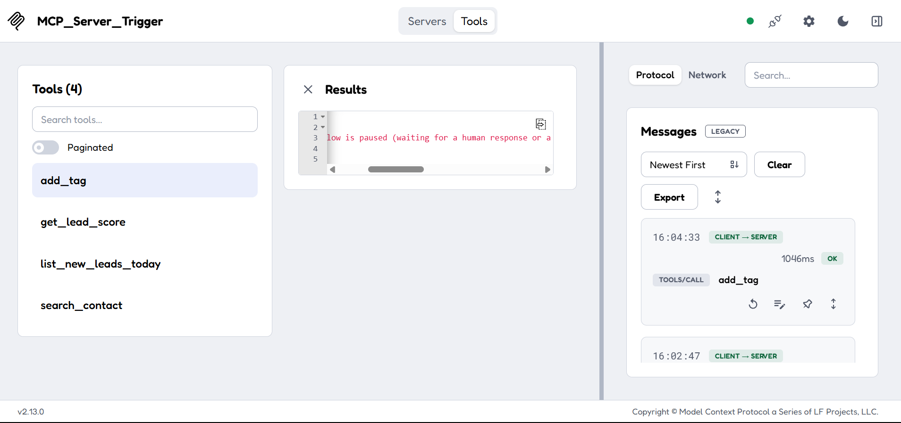
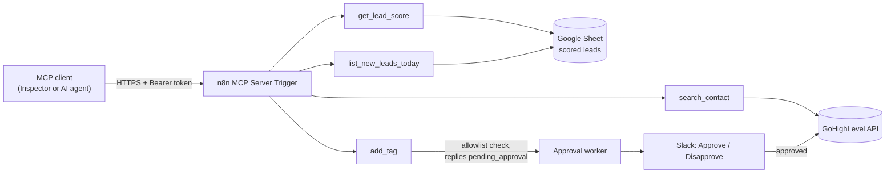
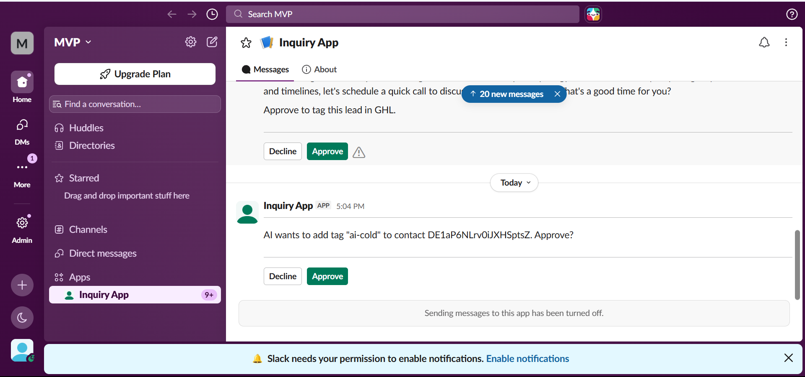

# GHL Lead Pipeline MCP Server (built in n8n)

An MCP server that lets an AI assistant look up leads, read their AI scores, list today's new leads, and request CRM changes, with a human approving every write.

**Built by:** Oluwaseyi Olowoyo · [https://www.linkedin.com/in/oluwaseyi-olowoyo-a9b3a3217/] · [olowoyoeniolaseyi@gmail.com]

**Stack:** n8n · Model Context Protocol (MCP) · GoHighLevel API · Google Sheets · Slack · MCP Inspector

[](https://youtu.be/E5gqNxgrvZM)

🎥 **[Watch the demo on YouTube](https://youtu.be/E5gqNxgrvZM)**



---

## The story in one minute

I had already built an automated lead-to-booking system ([ai-lead-qualification-n8n-ghl](https://github.com/olowoyoeniolaseyi-netizen/ai-lead-qualification-n8n-ghl)): a GoHighLevel form fires a webhook into n8n, an LLM scores the lead, a human approves it in Slack, and the CRM gets tagged. It worked, but only when a form was submitted. Nobody could simply ask it a question.

So I created a straightforward way to access it. This project wraps that pipeline in an **MCP server**, which means any MCP-compatible AI client can now say, in plain language, "Who is this lead, how hot are they, and what came in today?" and get real answers from live data. And when the AI wants to change something in the CRM, it can only ask. A human has to say yes.

The interesting part wasn't connecting an AI to an API. It was deciding what an AI should be *allowed* to do, and building the guardrails to match.

---

## What it does

| Tool | Type | What it does |
|---|---|---|
| `search_contact` | Read | Finds a GoHighLevel contact by email. Returns name, tags, source and **contact ID**. |
| `get_lead_score` | Read | Looks up a lead's AI score and category by contact ID (from a Google Sheet). |
| `list_new_leads_today` | Read | Returns up to 10 leads scored today (Lagos time), newest first. |
| `add_tag` | Write, **gated** | Requests a tag on a contact. Returns `pending_approval` immediately; the tag is applied only if a human approves in Slack. |

The tools are designed to chain. Ask about a lead by email and the AI calls `search_contact`, takes the contact ID from the result, then calls `get_lead_score`. The tool descriptions tell it how.

---

## Architecture



Each tool is its own n8n sub-workflow, attached to the server through a *Call n8n Workflow Tool* node. That keeps tools testable on their own and lets me add or remove one without touching the others.

---

## Design decisions

**Reads are free, writes are gated.** Three tools can only look. The one tool that changes data cannot act on its own: it posts an Approve/Disapprove message in Slack and only applies the change after a human clicks Approve.

**An allowlist, not a free-text field.** `add_tag` accepts only a fixed list of tags. If the AI invents a tag, the request is rejected before anything reaches Slack or the CRM.

**Asynchronous approval.** My first version waited for the human inside the tool call. That fails over MCP: a paused workflow can't return its final answer to the client. The fix was to reply `pending_approval` straight away and let a separate worker wait for the click and apply the tag. The tool description also tells the AI not to retry, so it can't spam Slack.

**Every answer is explicit.** A missing contact returns `found: false` with a message, never a blank or an error. An AI handles "not found" far better than silence.

**Bounded outputs.** Lists are capped at 10 rows so a tool can never flood a model's context.

**Clean, typed fields.** Booleans are real booleans and tags are real arrays, so the model doesn't have to untangle text.

**Authenticated endpoint.** The server requires a bearer token, and the GoHighLevel Private Integration token carries only the scopes it needs (read for lookups, write only for tagging).

---

## Problems I hit and how I fixed them

**Every lookup returned the same contact.** Searches for real and fake emails gave identical answers. The cause: I had mapped the tool's `email` input with an expression pointing at a previous node, but a tool node has no previous node, so the search ran with an empty query and GoHighLevel returned its first contact. The fix was to let the AI define the parameter, and to add an empty-input guard so a blank search can never return a random lead.

**A 422 from GoHighLevel.** I had named the query parameter `email`; the search endpoint expects `query`. Reading the request body in the n8n error panel found it in seconds.

**Tests looked wrong because of pinned data.** A pinned trigger kept replaying one saved input in manual tests. Unpinning it made tests honest again.

**Saved is not published.** The live MCP endpoint serves the last *published* version, so fixes didn't show up in the client until I republished the server and every sub-workflow.

**Synchronous approval can't return through MCP.** Covered above, and the reason `add_tag` uses a background worker.

---

## Testing

I tested with [MCP Inspector](https://github.com/modelcontextprotocol/inspector) against a test contact.

- [x] Server connects over Streamable HTTP and rejects a wrong bearer token (403)
- [x] `search_contact`: real email returns the contact; fake email returns `found: false`
- [x] `get_lead_score`: real contact ID returns score and category; made-up ID returns `found: false`
- [x] `list_new_leads_today`: returns today's leads, or `found: false` on a quiet day
- [x] `add_tag` responds immediately with `pending_approval` and posts to Slack
- [x] `add_tag` approved: the tag appears on the contact in GoHighLevel
- [x] `add_tag` disapproved: the contact is unchanged
- [x] `add_tag` with a tag outside the allowlist: rejected with no Slack message



---

## Run it yourself

**Requirements:** an n8n instance, a GoHighLevel sub-account with a Private Integration token, a Google Sheet of scored leads keyed by contact ID, and a Slack workspace.

1. Import the workflows from [`/workflows`](workflows/) into n8n.
2. Create credentials: GoHighLevel (Header Auth with `Authorization: Bearer <token>`), Google Sheets, Slack, and a Bearer Auth credential for the MCP server.
3. In each workflow, set your GoHighLevel Location ID, your sheet and tab, and the Slack channel. Adjust the column names in the `list_new_leads_today` Code node to match your sheet.
4. **Publish** every workflow, including the sub-workflows. The live endpoint serves published versions only.
5. Copy the Production URL from the MCP Server Trigger node and connect:

```bash
npx @modelcontextprotocol/inspector
```

Choose Streamable HTTP, paste the URL, and add the header `Authorization: Bearer <your token>`.

---

## Repository layout

```
.
├── README.md
├── workflows/        # sanitised n8n workflow exports (JSON)
├── screenshots/      # Inspector, Slack approval, GoHighLevel result
└── docs/             # optional: SOP and notes
```

Workflow exports are sanitised: credential references, webhook paths, location IDs, sheet IDs and tokens are removed. **Never commit secrets.**

---

## Known limitations

- Scores are read from a Google Sheet keyed by contact ID, so lookups by email need `search_contact` first. The chaining is deliberate, but it is two calls.
- `list_new_leads_today` depends on the sheet's timestamp format and uses Lagos time.
- Approval requests that nobody answers simply expire; there is no reminder.
- Tested with MCP Inspector. I have not yet run the server from a production AI agent.

## What I'd build next

- Audit log: record every tool call (tool, input, outcome, timestamp) to a Google Sheet.
- An n8n AI Agent node as an MCP client against this server, with a recorded demo.
- Per-tool rate limits and a reminder message for pending approvals.

---

## What I learned

How MCP tools are discovered and described to a model, why tool names, descriptions and input schemas matter as much as the logic behind them, how to keep an AI inside safe boundaries with read/write separation, allowlists and human approval, and how to debug a live integration systematically from request body to published version.

---

*Questions or ideas? [https://www.linkedin.com/in/oluwaseyi-olowoyo-a9b3a3217/] · [olowoyoeniolaseyi@gmail.com]*
